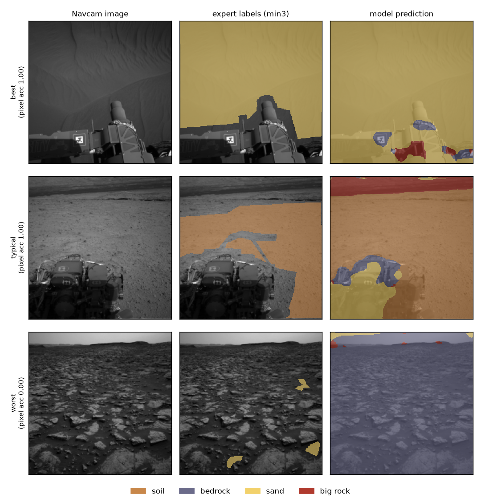
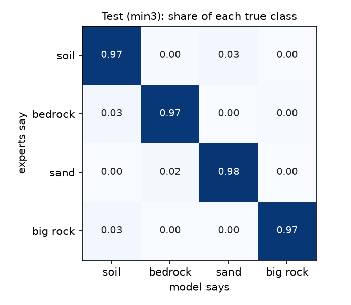

# Mars Rover Terrain Segmentation (NASA JPL AI4Mars)

A U-Net with an ImageNet-pretrained ResNet-18 encoder labels every pixel of a Curiosity
Navcam image as **soil, bedrock, sand or big rock**, the kind of terrain map a rover path
planner needs. Data: [AI4Mars (Swan et al., CVPR Workshops 2021)](https://openaccess.thecvf.com/content/CVPR2021W/AI4Space/papers/Swan_AI4MARS_A_Dataset_for_Terrain-Aware_Autonomous_Driving_on_Mars_CVPRW_2021_paper.pdf).

New to this? Start with **[LESSON.md](LESSON.md)**: concepts first, then a code walkthrough.

## Results (official expert-labelled test set, never seen in training)

| Test labels | Images | mIoU | Pixel accuracy | soil IoU | bedrock IoU | sand IoU | big rock IoU |
|---|---:|---:|---:|---:|---:|---:|---:|
| **min3** (≥3 experts agree) | 286 | **0.800** | **97.0%** | 0.956 | 0.932 | 0.923 | 0.389 |
| min1 (≥1 expert labelled) | 321 | 0.645 | 90.7% | 0.885 | 0.784 | 0.820 | 0.094 |
| *Baseline: "everything is soil" (min3)* | 286 | *0.128* | *51.3%* | | | | |

For context: Swan et al. report over 96% overall accuracy for DeepLabv3 trained on the *full*
AI4Mars training set, and a 2024 paper ([MarsSeg](https://arxiv.org/abs/2404.04155)) reports
79.5 mIoU for DeepLabv3+. Their exact test-label versions may differ from ours, so treat
these as rough context, not a head-to-head comparison.





### What it gets wrong, and what the numbers hide

- **The headline 97% is on the *easy* pixels.** min3 keeps only pixels where three experts
  agreed, which are mostly large uniform patches. Per-image accuracy on min3 has a median of
  1.00. On min1, which includes the contested pixels, mIoU drops from 0.80 to 0.65. That drop
  is the honest measure of how hard the boundaries are.
- **Big rocks are over-predicted.** On min3 the model finds 97% of true big-rock pixels, but
  only 39% of its "big rock" pixels are right (on min1: 47% recall, 10% precision). The
  confusion matrix above is normalised per *true* class, which hides this; the precision
  numbers are in `results/metrics.json`. The likely cause is the 2.6× class weight on a class
  that is just 0.07% of min3 pixels. Rock outlines are also where experts disagree most.
- **Sand pockets inside bedrock get absorbed** (bottom row of the examples: experts agreed
  only on two small sand patches, and the model calls the whole scene bedrock). Small regions
  are hard at 256×256, where one pixel is about 4 original pixels.
- **The rover's own body and the far horizon get labels too.** Both are masked out of training
  and scoring, so the model has never been told what they are. A deployed system would apply
  the same rover/range masks to its output.
- **Validation was easier than test**: 0.798 val mIoU vs 0.645 on min1. Validation is a random
  10% of the training shards, and neighbouring Navcam frames often show the same scene, so
  it's optimistic. It was used only to pick the checkpoint.

## Data (a documented subset)

AI4Mars is about 30 GB in its original form (MSL + MER images, several label versions). We use
the MSL portion as re-packaged to Parquet in
[`hassanjbara/AI4MARS`](https://huggingface.co/datasets/hassanjbara/AI4MARS) (a copy of the
Kaggle mirror), pinned to commit `93dbb79`:

- **Train: 3 of 13 shards** (0, 6, 12, spread out since shards follow image order), about 1.4 GB.
  After dropping images with < 1% labelled pixels: **3,060 train + 339 validation** images (random
  90/10 split, seed 42). The full training set has 18,130 images.
- **Test: the official expert set**, both `min3` (286 usable images) and `min1` (321).
  The prep script also checks that no test image appears in the training shards.

Preprocessing: 1024² → 256² (bilinear for images, nearest-neighbour for labels), and pixels
under the rover mask or beyond 30 m set to *ignore* (255).

## Reproduce

```bash
git clone https://github.com/Nipuna-Lakruwan/mars-terrain-segmentation.git && cd mars-terrain-segmentation
# optional: export UV_CACHE_DIR / TORCH_HOME / HF_HOME to keep caches on a roomier disk
uv sync
uv run python scripts/download_data.py   # ~1.6 GB
uv run python scripts/prepare_data.py    # -> data/processed/*.npz (~160 MB)
uv run python scripts/train.py           # 12 epochs; 151 min wall-clock on a heavily loaded M1 (MPS), one epoch stalled ~90 min
uv run python scripts/evaluate.py        # metrics.json, confusion matrix, example gallery
uv run pytest                            # IoU maths + model shape tests
```

Model: U-Net decoder (4 up-blocks, BatchNorm) on ResNet-18 (ImageNet weights, first conv
collapsed to one grey channel), 14.3 M parameters. AdamW (lr 3e-4, OneCycle), batch 16,
cross-entropy with 1/√frequency class weights and `ignore_index=255`, left-right flip and
brightness/contrast augmentation. Best checkpoint by validation mIoU (epoch 11 of 12).

## What's verified

- IoU / confusion-matrix code: unit tests with hand-computed answers.
- Test images are disjoint from training images (checked by filename in `prepare_data.py`).
- All numbers above come from `results/metrics.json` of the final run.
- Not verified: the causes given for big-rock over-prediction (class weight vs label
  disagreement). Training once without class weights would settle it (see LESSON.md, exercise 2).

## Resume bullet

> Fine-tuned a ResNet-18 U-Net (PyTorch, Apple MPS) on NASA JPL's AI4Mars Curiosity imagery
> to segment soil, bedrock, sand and big rocks; reached 0.80 mIoU / 97% pixel accuracy on the
> expert-consensus test set (0.65 mIoU on the stricter all-expert labels), using about a
> sixth of the training data.

## License

Code: MIT (see `LICENSE`). Data belongs to its original publishers (NASA / JPL; see the Data section) and is not included in this repository.
